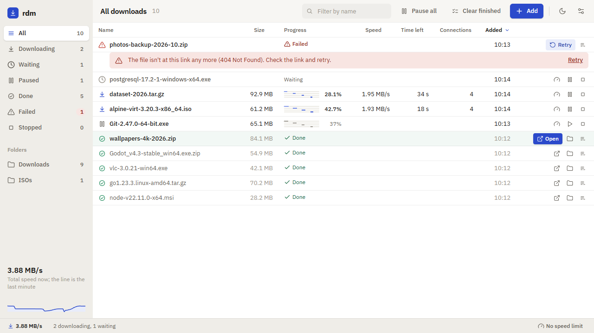

# rdm — Rust Download Manager

Download big files faster and never start over. rdm splits each file across
several connections, pauses and resumes across restarts, and comes as both a
command-line tool and a desktop app.

<picture>
  <source media="(prefers-color-scheme: dark)" srcset="docs/screenshots/main-dark.png">
  
</picture>

## Highlights

- **Faster downloads:** each large file is split across several connections.
- **Never start over:** resumes after a crash, restart or Ctrl-C.
- **In control:** pause, resume, stop and speed limits.
- **A queue (GUI):** downloads wait their turn; paste many links at once.
- **Archive and tags (GUI):** archive finished downloads and filter by tag.
- **Verified:** optional SHA-256 checksum checked before the file is saved.
- **Safe names:** files stay in your folder and never overwrite another.
- **See it work (GUI):** live connection lanes, a speed graph and a per-download log.
- **One engine:** the CLI and the desktop app share it.

For the details behind each of these, see
[How rdm works](docs/how-it-works.md).

## Install

Download the desktop app or the command-line tool from the
[Releases page](https://github.com/SimonPerryman/rust-download-manager/releases/latest),
or install the CLI with one command:

```sh
# macOS and Linux
curl --proto '=https' --tlsv1.2 -LsSf https://github.com/SimonPerryman/rust-download-manager/releases/latest/download/rdm-installer.sh | sh

# Homebrew
brew install simonperryman/tap/rdm
```

```powershell
# Windows
powershell -ExecutionPolicy Bypass -c "irm https://github.com/SimonPerryman/rust-download-manager/releases/latest/download/rdm-installer.ps1 | iex"
```

The builds aren't code-signed yet, so Windows and macOS warn on first launch.
[Installing rdm](docs/install.md) lists the app's installers by platform,
how to get past those warnings, how to update, and how to build from source.

## Quick start

```sh
# Download into the current directory (the file name comes from the server):
rdm https://example.com/big-file.zip

# Choose where to save it, and use up to 8 connections:
rdm https://example.com/big-file.zip -o ~/Downloads/archive.zip -c 8

# Cap the speed at 2 MiB/s:
rdm https://example.com/big-file.zip --limit-rate 2M

# Verify the result against a SHA-256 checksum:
rdm https://example.com/big-file.zip --checksum sha256:<hex>
```

Interrupted, or pressed Ctrl-C? Run the same command again to resume. The
[CLI reference](docs/cli.md) has every flag.

## Documentation

- [Installing rdm](docs/install.md): downloads by platform, unsigned-build
  warnings, updating and building from source.
- [CLI reference](docs/cli.md): flags, resuming, exit codes and logging.
- [Using the GUI](docs/gui.md): the window, shortcuts, settings and where
  state is kept.
- [How it works](docs/how-it-works.md): segmenting, resume, retries and
  integrity checks.
- [Contributing](CONTRIBUTING.md): building and testing from source, and
  cutting a release.

## Project status

Early, but usable. See the [roadmap](roadmap.md) for what's done and what's
next.

## Security

Please report vulnerabilities privately through GitHub's
[Report a vulnerability](https://github.com/SimonPerryman/rust-download-manager/security/advisories/new)
form, not in a public issue. See [SECURITY.md](SECURITY.md) for what to
include and what to expect.

## Licence

Dual-licensed under either [MIT](LICENSE-MIT) or
[Apache-2.0](LICENSE-APACHE), at your option. Bundled third-party icons and
fonts are credited in [THIRD-PARTY-NOTICES.md](THIRD-PARTY-NOTICES.md).
