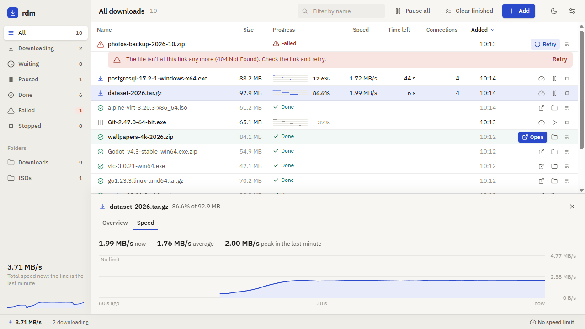

# Using the GUI

The desktop app (Tauri + React) shows every download in one sortable table,
keeps the list across restarts, and has light and dark themes. To install it,
see [Installing rdm](install.md#desktop-app); to build it, see
[CONTRIBUTING.md](../CONTRIBUTING.md#building-the-desktop-gui).

## Contents

- [Adding downloads](#adding-downloads)
- [Finding and selecting](#finding-and-selecting)
- [The queue](#the-queue)
- [Lanes and details](#lanes-and-details)
- [Completed and failed downloads](#completed-and-failed-downloads)
- [Archive and tags](#archive-and-tags)
- [Settings](#settings)
- [State and logs](#state-and-logs)

## Adding downloads

Add downloads with the **Add** button, by dragging a link onto the window, or
by pressing Ctrl/Cmd+V (outside a text box) with one or more links on the
clipboard. The dialog takes one link per line and previews each file's name
and site, skipped lines and links already in your list or in your archive
before anything starts ("Add 3 downloads"); a link you've archived is still
added, so you can download it again. Ctrl+Enter adds. The folder starts at the
one you used last. **Tags** (comma-separated) go on every download you add.
Under **More options** you can give a SHA-256 checksum and a speed limit.

## Finding and selecting

- **Filter** with the sidebar (by status, destination folder or
  [tag](#archive-and-tags)) or by name from the toolbar. Click a column header to sort. The sidebar also shows the
  total speed with a graph of the last minute. In a window narrower than about
  760 px the sidebar shrinks to an icon rail (hover an icon for its name) and
  less important columns hide.
- **Select** a row by clicking it; Ctrl+click adds or removes rows and
  Shift+click selects a range. With two or more selected, the toolbar offers
  the actions that apply to them all (Open, Pause, Resume, Stop, Retry,
  Tags…, Archive; in Archived, Unarchive and Remove).
- **Right-click** a row (or press Shift+F10 or the menu key) for every action
  that fits it, such as Show in folder, Copy link, Download again, Tags…,
  Delete partial file and Archive (in Archived, Unarchive and Remove).
- **Keyboard:** with the table focused, ↑/↓ move (Shift extends the
  selection), Home/End jump, Ctrl+A selects all, Space pauses or resumes,
  Enter opens a completed file, Delete archives (in Archived, removes) and
  Escape clears the selection.
- **Density:** the toolbar toggles compact 32 px rows (the default) and
  comfortable 48 px rows that also show each file's site.

## The queue

Downloads beyond the concurrency limit ([Settings](#settings); see
[how the queue works](how-it-works.md#the-queue-and-speed-limits)) wait, and
the first waiting one says **Next up**. To reorder, drag a waiting row by its
handle, press Alt+↑/Alt+↓, or use **Start next**, **Move up** and **Move
down** from its menu or the details pane.

You can pause, resume or stop any download, and choose whether a stop keeps
the partial file.

## Lanes and details

- **Lanes:** a multi-connection download draws one line per piece of the file
  in the Progress column, showing where the piece sits and how far it has got.
- **Details:** click a row to open the details pane under the table; it then
  follows the row you select (drag its top edge to resize).
  - **Overview** shows sizes, speed, time left, the lanes, the link, the
    folder and the checksum. A completed download gets a summary such as
    "5.8 GB in 2 min 14 s, average 44 MB/s, checksum verified" and **Verify
    checksum**, which checks the file against a SHA-256 you paste.
  - **The lanes** in Overview are one bar per open connection, top to
    bottom in lane order, headed with how many are open ("3 lanes"). A bar
    appears when rdm opens a lane and merges back up when it closes. Each
    shows only its own lane's work: the piece it is on now, strong, and the
    pieces it finished earlier, soft, so no part of the file is drawn twice.
    A closed lane's work moves to the top bar (Lane 1's); if it left a piece
    unfinished, the rest shows dashed until another lane takes it. Past four
    lanes the bars scroll in place, so the pane keeps its size. Hover a bar
    for which lane it is, its piece, where that sits and how far it has got
    ("Lane 3 · piece 5 · 19.1–23.8 MB · 40% downloaded"). Paused or stopped,
    the bars become one bar of the work so far; once the download completes,
    they give way to one finish bar and a line such as "Downloaded in 4
    pieces · up to 3 lanes".
  - **Speed** graphs the last 60 seconds, with the speed limit as a dashed
    line.
  - **Log** tells the download's story in short lines, updating while the
    tab is open: how it started (size, whether it can resume, how many
    pieces and lanes), lanes being added, closed or capped by the server, a
    lane losing its connection and reconnecting, pauses and where it resumed, rate-limit
    waits, the checksum result, where the file was saved, and a closing
    summary:

    ```
    Started · 6.25 GB · resumable · 4 pieces, up to 4 lanes
    Added Lane 2 — now 2 lanes
    Added Lane 3 — now 3 lanes
    Closing Lane 3 — more lanes didn't speed this up
    Lane 2 lost connection — retrying (attempt 2)
    Lane 2 reconnected
    Paused
    Resumed at 3.10 GB
    Checksum verified ✓
    Saved to /home/me/Downloads/big.iso
    Completed · 6.25 GB in 9m 59s (active 7m 14s) · avg 14.7 MB/s · peak 38.0 MB/s · 1 retry
    ```

    Tick **Detailed** to also see each request (its byte range and the
    server's answer) and each lane picking up or taking over work, such as
    "Lane 2 finished piece 2, now on piece 5 of 8 (3.10 GB – 3.90 GB)" or
    "Lane 3 took over the back half of Lane 1's piece 1 (400 MB – 780 MB) as
    piece 6". The choice is remembered. rdm keeps a download's last 200
    lines, plus its last 300 detailed ones.

    **Copy** puts the lines shown on the clipboard, one per line as
    `HH:MM:SS  text`, with the detail only while Detailed is ticked; it says
    "Copied" for a moment (and tells a screen reader how many lines).
  - A finished download's lanes and log lines are kept only until the app
    closes; after a restart the pane shows the summary alone.



## Completed and failed downloads

- **Completed** downloads stay where they are, with **Open** and
  **Show in folder**, until you [archive](#archive-and-tags) them.
- **Failed** downloads are pinned to the top with the reason in plain words and
  a **Retry** button.

## Archive and tags

- **Archive** moves a finished download (Completed, Failed or Stopped) out
  of the working views into **Archived** in the sidebar, which counts them;
  nothing is deleted, and it keeps its details and log. **Archive finished**
  in the toolbar archives every Completed and Stopped download at once, with
  **Undo** for a few seconds. Each finished row also has an Archive button,
  and Delete archives the selection.
- **Archived** lists only archived downloads. Select some and choose
  **Unarchive** to move them back, or **Remove** to drop them from rdm for
  good: the downloaded file, and a partial file kept by Stop, stay on disk,
  while a failed download's partial file is deleted. Remove asks first; tick
  **Don't ask again** to skip that, and turn **Ask before removing** back on
  in [Settings](#settings). If its downloads leave the archive while it asks
  (Undo on the archive toast, say), the dialog closes and nothing is removed.
  Retrying or resuming an archived download moves it back too, and **Retry
  all failed** leaves archived ones alone (it isn't offered in Archived).
- **Tags** label downloads (up to 16, each up to 32 characters; case doesn't
  make a different tag). Add them in the Add dialog, from **Tags…** in a row's
  menu or the selection toolbar, or in the details pane's Overview, where a
  tag's × takes it off. The sidebar's **Tags** section lists each tag with a
  count and filters by it. It follows the view: under Archived it lists the
  archived downloads' tags and narrows the archive ("Archived › work");
  elsewhere it lists only the working downloads' tags.

## Settings

**Settings** (the sliders button) holds the theme under **Display**, and
under **Downloads** the number of concurrent downloads, the global speed
limit, the max connections per download and whether Remove asks first. The status bar shows the total speed, and you can click the global
limit there to change it.

## State and logs

The download list and settings are stored in `~/.rdm/state.json`. A list saved
by an older rdm opens as is; one saved by a newer rdm is refused rather than
opened and saved back without what this version doesn't understand: a dialog
names its version, and rdm closes when you dismiss it, leaving the list
untouched. rdm 0.1.0 predates that check, so going back to it opens the list,
but its first save drops archive flags and tags. Tags edited into the file by
hand are brought within the tag rules when it opens. The GUI also
writes a daily log in `~/.rdm` (`rdm.YYYY-MM-DD.log`, the last 7 kept), with
its level set by `RUST_LOG` (default `info`); the Log tab always shows
informational lines and up (and, with **Detailed**, rdm's debug lines too),
whatever `RUST_LOG` says. On
Unix, `~/.rdm` is made owner-only (0700), since the state file and logs hold
full download URLs.

Logged URLs and error messages drop any `user:password@` and fragment, and
replace a query string with `?<redacted>`, so they're safer to paste into a
bug report.

`RDM_HOME` relocates `~/.rdm`, and `RDM_DOWNLOAD_DIR` changes the Add dialog's
default folder.
